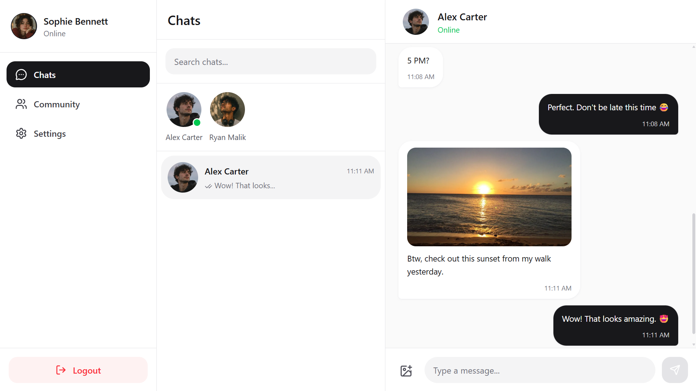
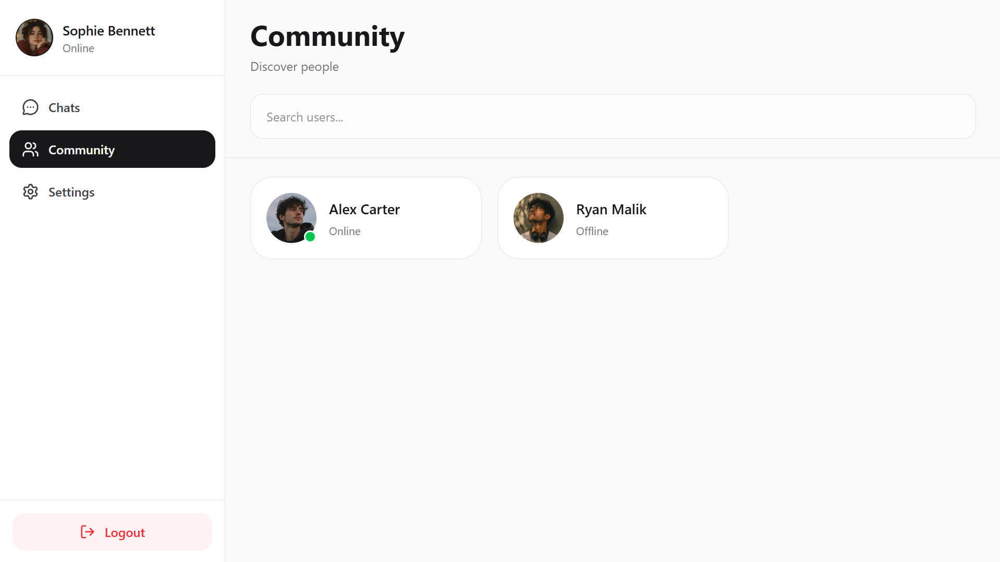
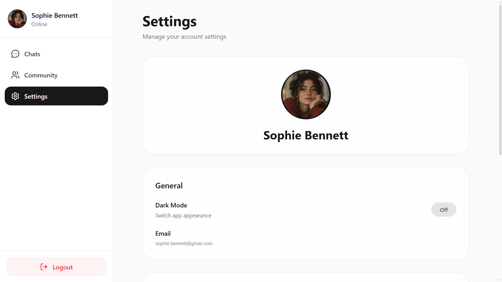
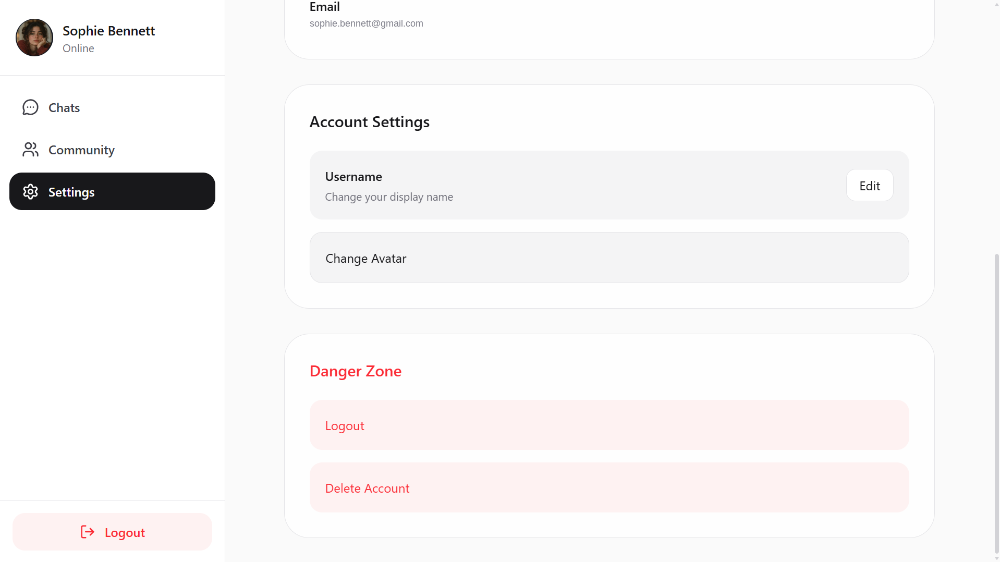
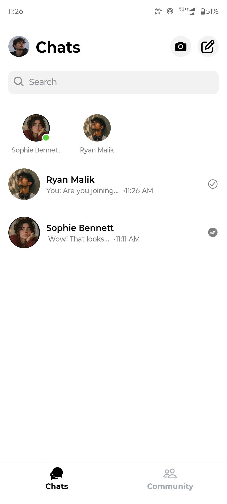
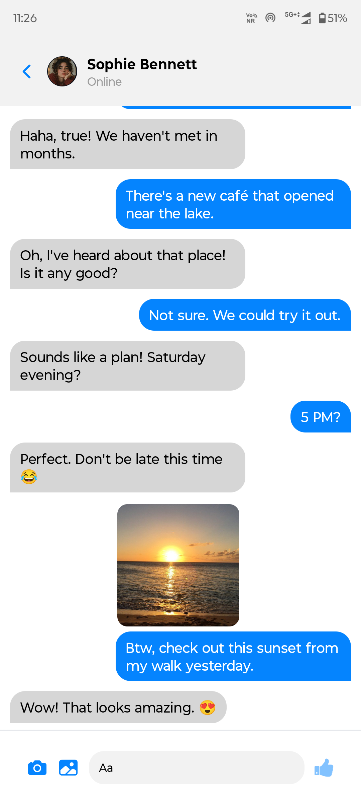
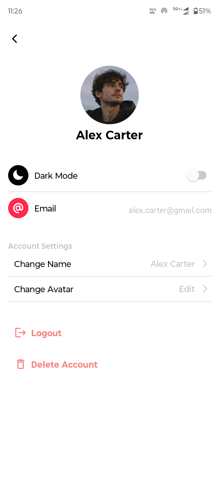

# Messenger

Messenger is a real-time messaging app with a React web client, an Expo mobile app, and a TypeScript backend. It supports direct conversations, media sharing, read receipts, online presence, and mobile push notifications.

[Live App](https://messenger-taupe.vercel.app/) · [GitHub Repository](https://github.com/Dev-2427/Messenger)

## Features

- **Authentication:** Sign up and sign in with credentials or Google, verify accounts by email, refresh sessions, and reset passwords.
- **Real-time direct messaging:** Exchange messages and see online presence updates through Socket.IO.
- **Message controls:** Edit and delete messages, mark conversations as read, and delete conversations.
- **Media sharing:** Send image and video attachments in conversations.
- **Mobile notifications:** Receive push notifications through Expo.
- **User discovery:** Browse and search users in the community view.
- **Recent chats:** Browse conversations and, on the web client, search by contact name or latest message.
- **Profiles and settings:** Update your username and avatar, switch themes, and manage your account.

## Screenshots

### Web






### Mobile





## Clients

- **React web app:** `react_web/`
- **iOS and Android app:** `frontend/` (Expo)

## Tech Stack

**Web**

- React 19, TypeScript, Vite
- React Router, Zustand, Axios
- Tailwind CSS, React Hook Form, Zod
- Socket.IO client and Google OAuth

**Mobile**

- React Native, Expo SDK 54, Expo Router
- TypeScript, NativeWind, Zustand
- Expo SecureStore, Expo Notifications, Socket.IO client

**Backend**

- Node.js, Express 5, TypeScript
- MongoDB and Mongoose
- Redis and the Socket.IO Redis adapter
- JWT authentication and Google OAuth
- ImageKit for media storage
- Resend for verification email
- Expo Server SDK for push notifications

## Project Structure

```text
Messanger/
├── backend/     # Express API, MongoDB models, authentication, and Socket.IO server
├── frontend/    # Expo app for iOS and Android
└── react_web/   # React web app
```

## Getting Started

### Prerequisites

- Node.js 20 or newer
- npm
- MongoDB
- Redis
- Google OAuth credentials
- ImageKit credentials
- A Resend API key for verification emails

### 1. Configure the backend

Create `backend/.env`:

```env
PORT=3000
NODE_ENV=development
URL=http://localhost:5173

MONGODB_URI=your_mongodb_connection_string
REDIS_URL=your_redis_connection_string

ACCESS_TOKEN_SECRET=replace_with_a_long_random_secret
REFRESH_TOKEN_SECRET=replace_with_a_long_random_secret
ACCESS_TOKEN_EXPIRY=15m
REFRESH_TOKEN_EXPIRY=30d

GOOGLE_CLIENT_ID=your_google_oauth_client_id

IMAGEKIT_PUBLIC_KEY=your_imagekit_public_key
IMAGEKIT_PRIVATE_KEY=your_imagekit_private_key
IMAGEKIT_URL_ENDPOINT=your_imagekit_url_endpoint

RESEND_API_KEY=your_resend_api_key
```

Keep real credentials private. Never commit `.env` files.

### 2. Start the backend

```bash
cd backend
npm install
npm run dev
```

The API listens on port `3000` by default. The health endpoint is available at `/health`.

### 3. Configure and start the web app

Create `react_web/.env`:

```env
VITE_URL=http://localhost:3000
VITE_GOOGLE_CLIENT_ID=your_google_oauth_client_id
```

Then run:

```bash
cd react_web
npm install
npm run dev
```

Vite prints the local web address when it starts. Add that address to the authorized origins for your Google OAuth client.

### 4. Configure and start the mobile app

Create `frontend/.env`:

```env
EXPO_PUBLIC_API_URL=http://YOUR_COMPUTER_LAN_IP:3000
EXPO_PUBLIC_GOOGLE_WEB_ID=your_google_web_client_id
EXPO_PUBLIC_GOOGLE_IOS_ID=your_google_ios_client_id
EXPO_PUBLIC_IMAGEKIT_UPLOAD_URL=your_imagekit_upload_url
EXPO_PUBLIC_IMAGEKIT_PUBLIC_KEY=your_imagekit_public_key
```

For a physical phone, use an address the phone can reach on your network instead of `localhost`. Use the appropriate local address for your Android emulator or iOS simulator.

Start Expo:

```bash
cd frontend
npm install
npm start
```

Use the Expo CLI to launch the app on an emulator or device. The project also includes `npm run android` and `npm run ios` scripts.

## Production Builds

Use `npm run dev` for local development. The commands below build and serve production output locally; `npm run preview` requires a successful `npm run build` first.

Build the backend:

```bash
cd backend
npm run build
npm start
```

Build the web app:

```bash
cd react_web
npm run build
npm run preview
```

Create mobile production builds using the project’s Expo Application Services configuration.

## Deployment Notes

- Deploy the backend, web app, and mobile app with their required environment variables configured in the relevant hosting services.
- Set backend `URL` to the deployed web app origin so credentialed web requests and Socket.IO connections can connect.
- Set web `VITE_URL` and mobile `EXPO_PUBLIC_API_URL` to the deployed backend URL.
- Email/password sign-in currently has a production-only issue in the deployed web app. It works in local development; the production issue remains unresolved.
- Add local and deployed web origins to the Google OAuth client configuration.
- Configure MongoDB, Redis, ImageKit, and Resend credentials in the backend environment.
- Use an HTTPS backend URL for deployed clients.
- Do not expose backend secrets in web or mobile environment variables. Variables prefixed with `VITE_` or `EXPO_PUBLIC_` are included in client-side builds.